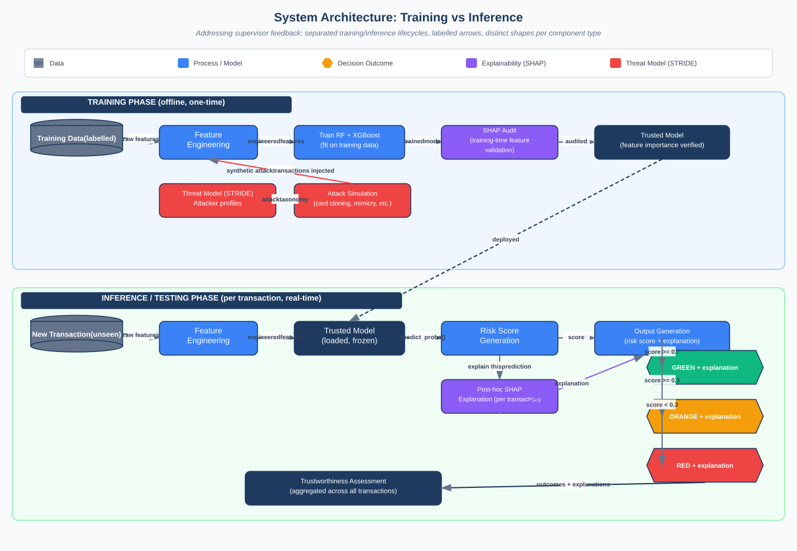

# Trustworthy ML-Based Fraud Detection for Card-Present Payments

**Can a fraud detection model be trusted when attackers adapt to it?** This project
threat-models a machine-learning fraud detector with STRIDE, attacks it with simulated
fraud patterns, and uses SHAP explainability to show *why* each model flags (or misses)
a transaction.

MSc dissertation · University of Nottingham · MSc Cyber-Physical Systems (Cyber Security) · 2025–2026
Author: **Sara Belhaiba** · Supervisor: Prof Christian Wagner



## What this project does

| Stage | What I built |
| --- | --- |
| **Threat model** | STRIDE analysis of a card-present payment pipeline, with data-flow diagrams and trust boundaries, turned into a five-type attack taxonomy |
| **Detection models** | Random Forest and XGBoost (supervised) plus Isolation Forest (unsupervised), trained on ~285,000 real transactions with a 0.17% fraud rate |
| **Class imbalance** | Compared no resampling, random undersampling and class weighting, then selected by F1 score |
| **Validation** | Stratified cross-validation with variance analysis, threshold sensitivity, statistical significance tests |
| **Explainability** | SHAP analysis across all three models to compare what each one relies on |
| **Attack simulation** | Card cloning, amount manipulation (tampering), velocity attacks, account sharing and mimicry (adversarial evasion), each evaluated for detection robustness |
| **Decision support** | A "traffic light" framework that combines Random Forest and XGBoost scores into green / orange / red zones, so analysts know which alerts to trust, review or block |

## Threat model → attacks

| STRIDE category | Simulated attack |
| --- | --- |
| Spoofing | Card cloning, velocity attacks |
| Tampering | Amount manipulation |
| Elevation of privilege | Account sharing |
| Adversarial evasion (added to STRIDE) | Mimicry: fraud reshaped to look like legitimate behaviour |

Repudiation, information disclosure and denial of service were assessed and scoped out. Sequence diagrams for each attack are in [`diagrams/`](diagrams/).

## Tech stack

Python · scikit-learn · XGBoost · SHAP · pandas · NumPy · SciPy · matplotlib / seaborn

## Run it

1. Download the [ULB Credit Card Fraud dataset](https://www.kaggle.com/datasets/mlg-ulb/creditcardfraud)
   and place `creditcard.csv` in a `data/` folder at the project root.
2. Install and run:

```bash
pip install -r requirements.txt
python src/pipeline.py
```

The pipeline runs end to end and writes results to `results/`, trained models to
`models/` and figures to `figures/`.

## Repository structure

```
src/pipeline.py      Full pipeline: preprocessing, imbalance comparison, training,
                     cross-validation, thresholds, SHAP, attack simulation,
                     traffic light framework
notebooks/           Demo notebook (data preparation and model training)
diagrams/            Architecture, threat model, data-flow and attack sequence diagrams
requirements.txt     Python dependencies
```

## Limitations and next steps

- **No card or account identifier in the dataset**, so card cloning, velocity and
  account-sharing attacks can only be approximated at the transaction level, not
  tracked per card.
- **Scaler fitted before the train/test split** on two features (Amount, Time). It is a
  small data leak, and the corrected ordering is the first planned fix.
- **Isolation Forest scores are normalised per batch.** Real-time scoring would need a
  fixed reference range.
- **Latency not yet benchmarked** for running three models plus SHAP per transaction.
